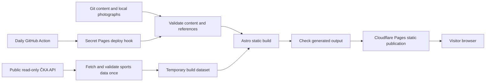

# Lokota Web — technical design

Status: **technical design approved by the owner on 2026-11-02; owner-requested refinements incorporated; local functionality implemented/verified and accepted; final visual acceptance pending; implementation committed/pushed; T-13 Pages handoff in progress; T-14 deferred**.
Date: 2026-11-02. Baseline: the approved [requirements.md](requirements.md), including the owner's Q-01–Q-10 answers, and [AGENTS.md](../AGENTS.md).

The owner authorized continuing after the initial documentation commit, then approved this design with "approved" on 2026-11-02. Decisions D-01–D-10 are the approved technical baseline. The subsequent [tasks.md](tasks.md) contains the approved implementation breakdown. No application code, dependencies, deployment configuration, or DNS changes have been introduced during these documentation phases.

## 1. D-01 — Static application and minimal toolchain

Use Astro static output, TypeScript, ordinary CSS, Markdown Content Collections, and local assets. Deploy generated files to Cloudflare Pages through GitHub integration. Visitors receive HTML/CSS/images; there is no request-time API dependency, application server, database, authentication, CMS, or frontend framework.

Use npm and commit its lockfile. Select Astro 7.4.4, the stable version observed in the official npm package metadata during this investigation, as the initial implementation baseline. Use Node 24 LTS, pinning one supported patch consistently for local development, CI, and Pages when scaffolding. TypeScript and @astrojs/check are development dependencies for meaningful type/content checks; choose compatible stable versions and lock them during implementation. Astro's documented Node minimum is currently 22.23.4, which Node 24 satisfies. Recheck compatibility if implementation happens substantially later.

Use Astro's exported Zod utility from astro/zod for content and external-data validation, rather than adding a second validation package. Use Node's built-in fetch, test runner, assertions, and TypeScript type stripping for simple build scripts/pure-module tests. This keeps the initial dependency list to Astro and its required build/check tooling. Node-run modules use erasable TypeScript, explicit relative import extensions, and no Astro virtual imports or TypeScript path aliases; type checking remains a separate step.

No Cloudflare runtime adapter, Wrangler, Worker, Pages Functions, utility CSS framework, image service, generated OpenAPI client, or SDD CLI is needed. If later compatibility testing reveals a required build dependency, record its concrete purpose before adding it.

Sources: [Astro installation prerequisites](https://docs.astro.build/en/install-and-setup/), [Astro package metadata](https://registry.npmjs.org/astro/latest), [Astro Zod reference](https://docs.astro.build/en/reference/modules/astro-zod/), [Node 24 TypeScript support](https://nodejs.org/docs/latest-v24.x/api/typescript.html), and [Pages build image overrides](https://developers.cloudflare.com/pages/configuration/build-image/).

Traceability: CON-01–CON-03, CON-05, CON-06; NFR-03, NFR-05, NFR-06, NFR-09.

## 2. System boundaries

The diagram describes the future flow, not configured resources. On a required fetch/validation/build failure, publication stops and the existing production deployment remains available. The Action only requests a build; Cloudflare performs the build and publication.

The future repository should contain only what those responsibilities need:

| Area | Responsibility |
| --- | --- |
| Astro configuration and package/lock files | Static output, shared Node/tool versions, scripts, production origin. |
| Site configuration | Central ČKA base URL, confirmed club id 279, Czech locale, Europe/Prague display convention, and shared navigation. No seasonal competition IDs. |
| Content collections | Manually maintained news, tournament editions, and club-information pages; assets may be colocated with entries. |
| ČKA integration modules | Response schemas, bounded HTTP/pagination, selection, normalization, and one build-dataset reader. No rendering concerns. |
| Feed/date helpers | Pure chronology, stable keys, Czech display formatting, and next-match selection. |
| Astro pages, layouts, and components | Render validated content/view data, navigation, cards, tables, gallery, and metadata. |
| Build scripts | Prepare the temporary sports dataset and validate local references/generated output. No independent framework or general plugin system. |
| Tests and small fixtures | Pure business/transform behavior and malformed/partial boundary cases; no full API dumps or personal contact records. |
| GitHub workflows | Offline checks for changes and the daily deploy-hook invocation, created only during authorized implementation/setup. |

Keep a few cohesive modules; split only when a real responsibility needs it. The data reader must not trigger HTTP requests during module import or once per page.

### Owner-authorized visual revision, 2026-11-02 (D-02/D-03/D-08/D-09)

Implement the detailed presentation request locally, following FR-01–FR-09 and NFR-01–NFR-04/NFR-08. The new request supersedes the old large-emblem feed fallback and sidebar placement of the next match; existing routes, data functions and content schemas remain unchanged. Do not require another design approval for this explicitly requested implementation.

Keep the Astro/CSS architecture. Use a compact shared header, locally available system sans serif, common navy #13243A / blue #2457A7 / off-white #F5F7FA tokens, restrained white sections, tabular numerals and independent outcome colors. Introduce a short navy club/season band with a CSS-only lane motif, immediately followed by the existing next-match card. On desktop they form the upper composition; in DOM and on phones the next match precedes the unchanged ten-item feed. Feature the first item; render photograph-free editorial entries typographically, retaining titles, summaries, dates and link destinations. Results keep explicit home/away scores and team identification. The A-team table, team overview and tournament remain in the supporting column.

Apply the same presentation to match cards, full semantic tables, article prose/duel cards, archives, club and tournament pages. Use narrow reading measures for prose and responsive duel cards without changing their logical structure. Preserve semantic tables and all columns in focusable horizontal scroll regions. A small dependency-free progressive enhancement may observe each region's actual overflow (ResizeObserver plus load), revealing a pre-rendered scroll hint only when necessary; without JavaScript the table and native scrolling remain usable. This is presentation/accessibility behavior, not data processing or a new product feature. No dependency, frontend framework, font download, API change or content rewrite is required.

T-19 badge refinement, owner-requested 2026-11-02: scope CSS to the homepage next-match metadata, add space below its existing accent rule, and let the date flex alongside the non-shrinking status badge. Wrap naturally when enlarged text needs more room, without changing MatchCard markup, status mapping or other match cards.

Verification uses an ignored copy of the original static output and sports dataset for comparable screenshots/semantic comparisons against the same inputs. Run a fresh normal build separately; record actual checks and limitations in T-19. No production changes are authorized.

### Owner-approved editorial homepage refinement, 2026-11-02 (D-02/D-03/D-08/D-09; T-20)

The owner approved implementing the proposed HC Tábor-inspired composition. Replace only the homepage composition with four latest entries from the existing sorted/filtered news collection. A small FeaturedNews Astro component renders one lead story and three compact previews; use validated local covers through Astro Image when present, otherwise navy CSS lane artwork. Keep a single semantic link per preview, dates/headings readable, no carousel or browser data dependence, and no new article fields. Use a compact identity/season heading instead of the separate slogan panel. Preserve #aktualne and existing heading anchors.

Reuse MatchCard with supplied/local opponent logos and explicit links to the original #zapas-ID destinations. Show three upcoming matches by repeatedly applying unchanged nextMatch to remaining IDs; keep the first selection identical. Select three recent completed match IDs from the existing mixed feed rather than creating another result/status/date policy. Render upcoming before results in DOM/mobile order, then the unchanged A-team standings data in a full-width section, followed by team/tournament links. Display competition context above each match card, with the existing date/status/home-away/venue/round/result details retained. All /novinky/, pagination, archives, /zapasy/ and /tabulky/ contents/order remain unchanged. No changes to preparation, schemas, score/date helpers or API calls.

Verify all unchanged routes against the saved same-input output; assert homepage's deliberate new selection/chronology against existing content/nextMatch/feed functions, including fewer/empty entries. Check photo and CSS fallback authoring, draft exclusion, all five viewport widths with enlarged text, contrast/focus/no-JS access and next-match reachability. Record local screenshots and actual check results in T-20; final appearance review and production gates remain separate.

Homepage sports-preview refinement, 2026-11-03 (FR-01/FR-03/FR-09; T-20): add an opt-in compact presentation to MatchCard, defaulting to the existing complete rendering. Only homepage callers enable it. Omit the venue line and visually hide side captions with the existing screen-reader utility; preserve their semantic order and accessible score label. Keep round context beside the existing competition name, use larger 56px emblems with appropriately sized local Astro image variants, and tighten spacing. Keep optional image sizing backward compatible for all other callers. No preparation/selection/data changes or new browser JavaScript.

Grouped club-overview refinement, 2026-11-03 (FR-01/FR-04/FR-07/FR-09; T-20): wrap the existing homepage standings and team/tournament blocks in one light-blue section using existing palette/spacing tokens. Use two equal columns: compact A-team standings on the left and the existing team/tournament blocks stacked on the right. Switch to a single column on mobile, without changing DOM reading order, table data, selection logic, links or heading IDs. Reduce table cell spacing and fixed numeric-column widths, keeping readable type and the existing TableScroll progressive enhancement. No new component/service/dependency or JavaScript is needed.

Publication authorization, 2026-11-03: the owner's explicit commit/push request permits publishing the current T-19/T-20 source and SDD changes to GitHub through the existing workflow. No deployment configuration, DNS or infrastructure changes are included; CI/Pages completion and live verification remain separate from Git publication.

Local jersey-red/photo trial, 2026-11-03 (FR-01/FR-09; NFR-01–NFR-03; T-21): retain the supplied photograph unchanged in src/assets/club-team.webp and import it only into the homepage through Astro Image. Render a modest 4:3 image beside the introduction with responsive local variants, intrinsic dimensions, a factual Czech alt and no cropping, overlays or enhancement service. Keep the introductory text and season within a wrapping group; narrow layouts must stay compact and readable at 200% text. Replace general blue action tokens with explicitly named accent tokens (red #B42332 and darker hover), leaving team-blue and all other team/outcome tokens unchanged. Use neutral panel tokens for the overview/table/scorecard surfaces. The hexadecimal choice is a UI choice inspired by the image, not a claim of official branding. No API/content-schema/selection logic or dependency changes. Verify screenshots, responsive layout, no-JS access, contrast and unchanged sports/content values before owner review; no publication authorized.

Warm palette refinement, 2026-11-03 (FR-09; NFR-01–NFR-03; T-21): update shared CSS tokens to warm near-white paper #FAF9F7, neutral panel #F1EFEC and warm gray borders #E2DFDB. Keep the current red action/hover/focus colors and use a warm red tint #FBEFED only for the grouped homepage overview and existing small accent states. Add a restrained red header rule and red introductory eyebrow, with softly tinted section dividers; leave white content panels, navy editorial artwork, all team/outcome tokens and layout unchanged. These are screen choices, not official branding codes. No new component, dependency, JavaScript or data/content changes are needed. Check actual text/focus contrast, responsive/200% text views and unchanged homepage markup.

Publication follow-up, 2026-11-03: the owner explicitly requested “commit and push” for the locally verified T-21 palette/photo work and supplied-photo gallery content. Publish through the existing GitHub/Pages integration; no delivery configuration changes are needed. This supersedes T-21's local-only Git restriction; CI/Pages results and live verification must be checked separately.

Homepage introduction artwork replacement, 2026-11-13 (FR-01/FR-09; NFR-01–NFR-03; D-02/D-08; T-42): retain the supplied 1672×941 PNG unchanged as src/assets/home-intro-2026-11-13.png and import it in the homepage through Astro Image instead of club-team.webp. Keep club-team.webp and its other consumers unchanged. Generate WebP widths 128/224/256/448 using the established eager-loading/sizes policy; infer height from the new source rather than carrying over the old 4:3 height. Rename the image class to home-intro-image, retain 224px desktop/128px mobile widths with automatic height, explicitly contain the image and remove rounded corner clipping. Describe the illustration's supplied headline/results in Czech alt text without treating illustrated content as a new data source. No new dependency, JavaScript, sports-data or content-model change is needed. Verify the source copy, optimized variant proportions, responsive full-frame display and production build.

Rejected ball-and-pin trial, 2026-11-13 (FR-01/FR-09; D-02/D-08; T-43): after reviewing the local CSS/SVG composition, the owner explicitly requested rollback. Remove the decorative wrapper, circle and inline pin SVG/styles, restoring T-42's direct Astro image with automatic height, object-fit:contain and 224px desktop/128px mobile widths/sizes. Retain the supplied source, alt and responsive image variants. The trial is historical evidence, not the current design.

Publication follow-up, 2026-11-13 (T-42/T-43): the owner authorized publishing the current T-42 rectangle after rejecting and reverting the ball/pin trial. Use the existing main-branch GitHub/Pages integration; no delivery configuration changes. Record exact commit, successful CI/Pages and the live full-frame image separately.

## 3. D-02 — Routes, information hierarchy, and feed

Use Czech labels and short stable ASCII URL segments:

| Public route | Responsibility |
| --- | --- |
| / | Club identity, four latest manual articles, three upcoming matches and three recent results, A-team standings, other-team overview and Žižkova 200 entry point (T-20). |
| /novinky/ | Complete paginated mixed feed, 10 entries per page. Further pages use /novinky/strana/2/ etc. |
| /novinky/{slug}/ | Manually authored article detail with optional cover and gallery. |
| /novinky/archiv/{year}/ | Published manual articles for the year, newest first; ordinary pagination if needed. |
| /zapasy/ | Latest-season matches grouped by competition and clearly labelled with club teams, upcoming matches and results, and stable match anchors. |
| /tabulky/ | Latest-season official standings grouped by competition, identifying all club teams. |
| /zizkova-200/ | Current tournament edition summary and links to edition results/archive. |
| /zizkova-200/{year}/ | One edition, description, on-page results, photos, qualification statement if known, and downloads. |
| /zizkova-200/archiv/ | Published past editions. |
| /klub/, /historie/, /kontakt/, /herna/ | Verified club information from Markdown. |
| /404.html | Czech missing-page response for static hosting. |

Editorial report pilot, 2026-11-02 (FR-02/FR-03/FR-05; T-16): use an ordinary Markdown news draft for the owner-requested first real A-team report. Research with the public OpenAPI and read-only API outside the website build; keep only relevant verified names, scores and source references in the authored article. Existing automatic match summaries remain deterministic and unchanged. Do not add a runtime generator, AI API, profile collection, player routes or build-time player-result retrieval. This pilot tests the editorial voice before deciding a future profile schema. The article date is its authoring/publication date; the actual match date stays explicit in the body. The owner subsequently approved publication on 2026-11-02: set draft=false and use the existing article route, feed, archive and sitemap without changing components or adding infrastructure.

No individual player routes are generated. Generated match news links to the stable match anchor on /zapasy/, not to fabricated Markdown articles or a new player/match-detail application. Use a season/competition link to the official source only when a verified public URL is available; never infer HTML URL patterns from API slugs.

Earlier homepage refinement, 2026-11-02 (FR-01/FR-04; placement superseded by T-20): render the A-team's complete official table as a supporting panel, showing rank, team, played matches and points. Highlight its row without relying on color alone. Select competitions from the current validated dataset by the confirmed club ID and exact published team name (central club name plus A), using match membership if the table is still empty. Do not hardcode seasonal IDs, fetch again, recalculate ranks or fall back to another team/season. T-20 moves this unchanged table below the curated stories and match summaries; retain the complete tables page and the all-team chronology on /novinky/.

The mixed feed contains a small discriminated view model: source kind, stable key, date, title, summary, optional image, and link. Manual keys use article slugs; match keys use the API match id, so corrections replace one entry rather than create another. A match between two club teams creates one feed item naming both teams and one uniquely anchored match entry on /zapasy/. No generated content is written back to Git and no generative-AI service is used.

Sort by the validated calendar date descending. For equal dates, manual articles precede generated summaries; use stable keys as the final deterministic tie-break. This deliberately uses day-level editorial chronology because article dates and some match times have no precise instant. Never use build/fetch time as a match's publication date. The most recent match receives no special permanent pin; all completed latest-season matches with dates can participate in the feed.

Include FINISHED and FORFEIT matches in generated news only when both official team-point values are available and the match date is not in the future. Use deterministic factual Czech text naming teams, competition, result, and a forfeit label when applicable. If points/date are absent, keep the match in the results section with an honest missing-data label and omit its generated dated news entry. Corrected or reopened matches are rebuilt from their current status. A manually written report may coexist with a generated factual entry; automatic deduplication applies to the same API match, not subjective article content.

Manual article archives persist across seasons; generated summaries cover the selected latest season and are derived anew at each build. Historical sports archives are not part of the initial scope. Content-only historical article/tournament additions remain supported.

Traceability: FR-01–FR-06, FR-08; Q-02, Q-03, Q-05; NFR-01, NFR-04.

## 4. D-03 — Content models and authoring

Use three Markdown collections with Astro's built-in glob loader and frontmatter schemas. Use plain Markdown, not MDX, so editorial content does not execute application components. Stable news slugs and tournament years determine URLs independently of title changes. Validate duplicates and reserved route segments; archive/strana must not be accepted as conflicting article slugs.

| Collection | Required information | Optional/default information |
| --- | --- | --- |
| News | Stable slug, title, publicationDate as a valid YYYY-MM-DD calendar date, summary, Markdown body. | Optional local cover image with meaningful alt; author; gallery of local image/alt/caption entries; draft=false. |
| Tournament editions | Unique year, name=Žižkova 200 by default, edition date/date range when known, description/body with a clearly headed results section. | Announcements in Markdown; isCurrent=false; draft=false; qualifiesForMcr absent/true/false; gallery; downloads as label plus local path. |
| Club pages | One of the four fixed page identifiers, title, summary/description, Markdown body. | Local images if supplied. Contact/venue details live in the Markdown instead of being invented in application code. |

Article scorecard, revised 2026-11-02 (FR-02/FR-03/FR-05; T-17): replace the rejected wide table with a static list of six duel cards in ordinary Markdown. Each card has an identifying heading and official player points, followed by two player sections with team/side labels, names, overall pins, four ordered lane tiles and total set points. Tiles show lane number, total pins and explicit lane points; use green for 1, amber for ½ and muted red for 0, with a text legend. Read official lane points rather than deriving them from pin totals. A two-column CSS grid compares opponents on larger screens, while narrow screens stack the player sections; tiles use a wrapping grid so enlarged text remains readable without sideways scrolling. Keep one DOM representation in logical home-then-away order, semantic headings and textual outcomes, rather than duplicate desktop/mobile markup or hide data. Keep official team pins/points in a compact summary and omit full/spare/errors detail per the owner's revision. Preserve the readable article width. No MDX, new frontmatter model, client JavaScript, runtime API dependency or generic rendering framework is necessary. Verify values against the researched public match/player responses; future authors can reuse this content pattern.

Store entries and photographs together where practical, with image metadata resolved through the collection image helper. Gallery item alt text is required; captions are optional. Do not require a photo on generated match cards. Under the owner's subsequent 2026-11-02 instruction, a news cover is optional. Under the later T-19 brief, omit cover frontmatter for a compact typographic entry in the full news listing without an image tile; T-20 homepage previews instead use intentional CSS lane artwork without a cover; validate supplied covers normally. Article detail pages omit the large cover figure when absent; no stock image or synthetic club photograph is needed. Clearly labelled neutral placeholders are permissible during development only and must be reviewed before public launch.

An edition may be announced before dates/results exist: represent unknown dates as absent and state that they will be announced. Validate startDate <= endDate when both are supplied, and label absent results as pending. Do not invent real edition dates or results just to fill the collection. News publication dates cannot be future-dated unless draft; scheduling future article publication is not an initial feature.

Use an explicitly selected published isCurrent edition when provided (at most one), otherwise the greatest published non-archived year. Historical editions use archived=true and cannot also be isCurrent. Adding another edition is content-only. Invalid duplicate years/current markers fail validation. Archive entries link to their permanent year page.

Žižkova 200 uses the owner's supplied wording: doubles, 200 hodů sdružených. Record MČR qualification per edition, omit the qualification claim when unknown, and show an explicit non-qualifier statement only when confirmed false. Results are a normal Markdown table in the results section, ordered as supplied. This supports flexible columns without speculative result import/ranking logic. Keep table headers/captions readable through Markdown styling and the surrounding section heading. If supplied real results cannot be represented accessibly this way, revisit a small structured table model before implementing it; do not introduce CSV/PDF parsers now.

Historical-results extension, 2026-11-03 (FR-07; T-22): representative supplied data justifies a small validated frontmatter model alongside existing Markdown results. Add archived=false and results=[] defaults. Each result group has a unique stable ASCII id, label and ordered pairs. A pair stores its printed positive position, exactly two players (name, club, full, spares, errors, total), source pair aggregates, optional category label/position and an optional source-anomaly note. Validate integer/nonnegative statistics and aggregate consistency; never calculate new rankings or require ranks/player names to be unique. Preserve source spelling and repeated starts. Keep source links/explanations in Markdown and original PDFs in year-specific public downloads. The one-time native PDF/text/HTML conversion is editorial preparation outside the app; there is no committed import tool or runtime parser.

Render one semantic ordered pair list with prominent source rank/pair total, two player blocks and labelled statistics. Compare players side by side on desktop, stack them on phones without hiding data or horizontal page scrolling. Keep prose at a comfortable width and pair results in the existing wider reading area. For structured archives, place long provenance notes inside a native keyboard-operable details/summary before the search and keep PDF links near the top; this keeps search reachable on phones without hiding source notes behind JavaScript. In 2023 retain separate category groups; in 2025 annotate the overall pairs with the verified category rank rather than duplicating starts. A tiny bundled module only on structured-result pages enhances a hidden-until-ready labelled search input/reset button and polite live count. Normalize Unicode decomposition/diacritics/case/spacing; require every query token in one player's name/club, retain the partner, hide unmatched pairs/empty groups, and preserve source DOM order. Do not put queries or personal details into URLs/storage/network requests. Without JavaScript every result remains visible, with browser-find guidance.

Exclude archived editions from currentEdition selection, retaining the prior fallback for non-archived entries and all historical year/archive/sitemap routes. Unknown archived dates do not display future announcement wording. Keep existing Markdown results, qualification tri-state, galleries, downloads, sports preparation and URLs unchanged. Extend shared content validation and meaningful tests for archive/current selection, pair schemas, search and real imported counts/source anomalies. Verify responsive/enlarged-text browser views, no-JS data, keyboard/reset, references and production/editorial builds. No new dependency, framework, API service or infrastructure is needed.

Tournament showcase refinement, 2026-11-12 (FR-07/FR-09; D-03/D-08/D-09; T-39): retain the existing content schema and year routes. Use a shared Astro tournament introduction with responsive local variants of the unchanged supplied illustration, readable adjacent title/discipline copy, and a labelled wrapping year/archive navigation. Landing uses a concise current-edition card, a latest-results preview selected independently by greatest published results year, and sidebar category winners; complete announcements remain on the permanent year page. Select previews and honours directly from stored printed positions (including ties) and category position=1, without sorting by performance or deriving rankings. If category ranks are absent, use each result group's printed first place and its exact group label. Archive includes current/past status, stored pair counts and links to all editions, with selected source-ranked yearly winners beside it. Year pages reuse the introduction/navigation at a smaller scale, keep the existing Edition and searchable full result list in the wider column, and use source-backed category panels alongside. Panels stack after primary content on narrow screens. Share only small cohesive components/selection functions and scoped CSS; no schema, service, dependency, third-party image request or additional browser JavaScript. Results remain static HTML and the existing local search enhancement stays unchanged. Check current-without-results fallback, group/category rank and ties, all source counts/statistics, original image hash, mobile/enlarged-text/keyboard/no-JS behavior, references and production build. Record local screenshots and verification in T-39 before owner appearance review; no Git publication is inferred.

Owner acceptance/publication authorization, 2026-11-12 (T-39): “je to ok, dostan to do produkce” approves the reviewed tournament layout and its publication through the existing main-branch/Pages integration. This supersedes only T-39’s earlier local-only publication state; implementation and infrastructure remain unchanged.

Downloadable PDF/CSV files are added to Git under a public downloads area and referenced by a validated local URL, e.g. a year-specific tournament file. Validate that paths stay inside that area, targets exist, labels are meaningful, and files meet Pages' asset limit. No browser upload form, storage service, or separate file administration is built. Photographs remain in Astro-processed source assets rather than the public downloads area.

Exclude drafts from every public listing, route, gallery/image import used by public output, and SEO/sitemap entry. Public downloads are public regardless of a content entry's draft flag; do not commit confidential draft attachments to the public area. Keep draft assets out of a standalone public directory. Validate draft frontmatter/references too; a draft is an editorial state, not a bypass for broken content.

Sources: [Astro Content Collections](https://docs.astro.build/en/guides/content-collections/). Traceability: CON-03; FR-02, FR-07–FR-09; A-04, A-06; Q-06–Q-08; NFR-05, NFR-06.

## 5. D-04 — Verified ČKA boundary and build dataset

Use only GET requests against the centralized https://kuzelky.cz/api/v1/public base URL. No ČKA credentials are needed. The [public OpenAPI schema](https://kuzelky.cz/api/v1/public/openapi?variant=public) was re-fetched on 2026-11-02; it remains OpenAPI 3.0.3, public API version 1.0.0, security=[]. Inspect current contract changes during implementation rather than committing the entire schema or generating a large client.

Prepare one normalized dataset before Astro prerendering. The preparation script uses the same typed integration modules as the unit tests, validates the whole required response set, and writes one ignored temporary JSON file atomically only on success. Astro pages read that file; they do not fetch separately. Each build command prepares its own fresh dataset and never silently uses a file left by an older build. The dataset includes schemaVersion, clubId, selected season metadata, fetchedAt, normalized teams/competitions/matches, and table states. It is build input, not a public API route or durable sports cache.

| Request | Purpose and required response shape |
| --- | --- |
| /seasons | Fetch all published season records; wrapper has items and total, without limit/offset. Select the latest by D-05. |
| /matches?clubId=279&seasonId={selected}&limit=100&offset={offset}&sort=id&include=homeTeam.club,awayTeam.club,competition.season,venue,results | Fetch every club match, home or away. Wrapper has items,total,limit,offset. Deep includes expand their parents. |
| /competitions/{slug}/rounds | Fetch the known competition's round numbers; live response is a bare integer array, despite the public response schema not describing its body. |
| /competitions/{slug}/rounds/{highestRound}/table?type=ALL&include=team.club&sort=position | Retrieve official cumulative totals and ranks. Wrapper has items,total. Keep the official position values; do not derive ranks. |

Those paths and parameter choices were exercised against the actual public API during this design investigation. Treat an invalid/absent required relation as an integration error; do not assume that a misspelled include would cause HTTP failure. The [API conventions](https://kuzelky.cz/api/docs/conventions/) say ignored includes may silently omit fields, and its authenticated examples are not authoritative for public filtering. For these public endpoints use the explicit filters verified in the public schema.

Validate the subset used by the website with small Zod schemas and infer its TypeScript types. Accept unrelated extra fields so additive upstream changes do not break the site; discard them during normalization. Do not copy referee/contact/bank details into the website dataset. Require valid positive ids, correct club/season associations, known statuses, valid dates/times where present, pagination metadata, and requested team/competition identity. Unknown enum values or wrong required field types fail the build with maintainer diagnostics.

Nullable/missing optional data is different from invalid data. Null date/time/venue, nullable scores, empty results, and empty official tables have explicit view states. Match results must have no duplicate home/away side; associate by isHome, never array order. Keep team points, pins (totalPerformance), and set points separate, including real zeros/half-points. A null is never converted to zero, and win/loss prose is not inferred from pins alone.

Fetch paginated matches sequentially in stable id order until all advertised records are read. Check progress, unique ids, stable total, and returned offsets; on shifting/duplicate/incomplete pages, retry the complete collection once, then fail rather than publish a truncated dataset. The API does not provide a transactional multi-request snapshot; consistency checks detect common races, not every concurrent edit. Independent competitions may be fetched with concurrency capped at two.

Use a 10-second request timeout and at most two retries for network failures, timeouts, 429, and 5xx, with short backoff and bounded Retry-After handling. Do not repeatedly retry 400/401/403/404 or schema errors. Cap the entire sports preparation at three minutes and the match collection at 100 pages; exceeding either reports an actionable failure. These are engineering bounds to review with real build measurements, not assumptions about an API rate-limit contract. Initially fetch full data: ETags are unnecessary without a trusted retained response body and a 304 alone cannot rebuild it.

Normal coverage is one seasons request, one or a few club-match pages, then two requests per discovered competition: currently about eight requests for 74 matches and three competitions. No per-player calls and no per-match detail fan-out are needed.

Team/competition discovery unions expanded club-side match identities and club teams present in their official tables. It does not claim to discover teams with no published matches in an otherwise undiscovered competition. The currently observed A–E teams are discovered, not hardcoded. A genuinely empty latest season yields an explicit preparation/no-matches state, not a search of older seasons or all national competitions. Revisit discovery only if real club participation cannot be covered.

Traceability: CON-04, CON-05; FR-03–FR-06, FR-10; NFR-06, NFR-07; R-01–R-04.

## 6. D-05 — Latest season, official tables, dates, and time

For each validated season, compute its chronological start as the earlier of q1StartDate and q3StartDate. Select the greatest start date from all published records. Active is useful metadata, not a permanently pinned filter or the sole tiebreak. Do not select by numeric id, array order, season-name parsing, the current calendar year, or the season that happens to have club matches. Equal latest start dates for distinct seasons are ambiguous: fail with diagnostics rather than guess. Missing/invalid season records are an integration failure; do not publish a fabricated season.

This implements the owner's literal latest-season preference: if ČKA publishes a newer future season, it becomes the default even before its first match. Show its real name and a preparation/empty state as needed, without falling back to the old season. Existing manual article/tournament archives remain accessible. All discovered competitions must report the selected season through the requested relation.

Use the greatest configured round number for the official ALL table, not the greatest completed club round or the last calendar weekend. [ČKA's standings documentation](https://kuzelky.cz/api/docs/statistics/) states that recalculation covers the changed finished/forfeited match's round and every later round. Thus the highest configured round's official table includes the available completed/forfeited results across the competition, including matches played out of numerical order. Live checks on 2026-11-02 confirmed this for all three club competitions:

| Competition | Highest configured round queried | Returned ALL rows | Observed club teams |
| --- | --- | --- | --- |
| 2. KLM A | 22 | 12 | Tábor A |
| Krajský přebor JČK 2 | 22 | 12 | Tábor B |
| OP Tábor | 14 | 7 | Tábor C, D, E |

These round numbers are observations, not configuration. Display the season and dataset update time and say current official table; do not imply that the final round has been played. Preserve official positions and show matches played, wins/draws/losses, and points, with scoring columns labelled as needed. Recalculation is asynchronous (the documentation says typically about two minutes); never repair a short mismatch by recalculating standings locally.

No rounds or a valid empty table means the table is not yet available; render that state without probing invented round=0 semantics or fabricating rank zero. A failed request or invalid table contract fails the new build. Recheck the highest-round cumulative behavior if ČKA changes its contract; it is a documented dependency, not a general rule inferred from bowling.

Keep match date as YYYY-MM-DD and time as the API's nullable HH:MM string. [The schedule documentation](https://kuzelky.cz/api/docs/competition-schedule/) confirms that wire representation but does not specify an offset for time. The chosen display convention is Czech local wall time, Europe/Prague; show the supplied calendar date/time without converting it to a fabricated UTC instant. This is a documented convention pending stronger API timezone evidence, not a claim that the API guarantees a timezone.

Capture one UTC fetchedAt instant for the build, and derive the Prague calendar date/clock using Intl for comparisons and Czech labels. Match/edition date-only values must not pass through a UTC-midnight conversion that can shift days. Date/time formatting uses built-in Intl, avoiding a date library. Around DST, preserve the source wall-clock label rather than guessing an offset.

Select the next match from SCHEDULED/PREPARATION entries with a future Prague date/time relative to the build. Today's match without time remains eligible with 'Čas bude upřesněn'. Older scheduled matches remain visible with their official status but are not promoted as the next match. IN_PROGRESS has its own label, not a finished result. With daily static refresh, summaries can age between builds; always show the last successful data-update time and avoid claims of live results.

Traceability: FR-01, FR-03, FR-04, FR-06, FR-10; Q-03; R-02, R-03.

## 7. D-06 — Outage behavior without durable sports storage

**Choose preserving the last successful deployment as the initial fallback.** On a required API transport, pagination, identity, or schema error, the new build exits unsuccessfully and nothing is published. Existing HTML, results, images, and assets remain served by Pages. A first build without any existing publication fails visibly to the maintainer and must be retried after recovery; no fake season, fixture results, or empty emergency sports data is published as real data.

Valid incomplete source information is handled differently: a null score/venue/time, empty results array, no matches, or no official table is a supported data state and can publish with clear Czech wording. Do not catch every exception and disguise it as an empty list. Preserve supplied official values wherever present.

Always show 'Sportovní data aktualizována …' using fetchedAt, and identify ČKA as the source. This label remains truthful when an old deployment stays online. A purely static old page cannot automatically change its warning after an outage, so no dynamically computed freshness guarantee is claimed and no client polling is added.

The approved tradeoff is intentional: **news/content changes also wait if the API is down**, even if the old site still works. The next successful daily or manual build refreshes both. If independent content publication during outages becomes a requirement, first design a trusted, versioned last-good sports artifact with explicit expiry/season/provenance validation. That is additional work, not something a deploy hook or an ephemeral build cache provides automatically.

| Alternative | Initial decision and reason |
| --- | --- |
| Fail the new build; retain published deployment | Selected. Meets the initial preference to retain published data with no persistence mechanism or extra infrastructure. |
| Reuse saved sports JSON/artifact across builds | Deferred. Would enable content updates during an outage but adds storage/promotion/concurrency/invalidation rules without a confirmed need. |
| Commit generated snapshots or match articles daily | Rejected initially. Adds routine repository writes/history churn and credentials/branch handling; content should remain editorial. |
| Worker/runtime proxy or browser API calls | Rejected. Adds runtime behavior and visitor/API coupling while daily SSG satisfies the stated freshness target. |

Local tests use small fixtures and injected fetch/clock functions. Offline UI development may use an explicitly labelled development fixture path; release/Pages build commands must require live preparation and reject fixture provenance. No fixture or stale temporary file is a production fallback.

Traceability: FR-10; CON-02, CON-05, CON-06; NFR-07; Q-04; R-04.

## 8. D-07 — Daily refresh and deployment

Use Pages Git integration for PR previews and production builds of main. The build command runs dependency installation from the lockfile, type/content/reference checks, sports preparation, Astro static build, and generated-output checks before publication. Concrete handoff settings: Node 24.22.2, SKIP_DEPENDENCY_INSTALL=1 to disable the provider's automatic install, build command npm ci && npm run build, output dist, and repository-root working directory. This performs one explicit lockfile install and pins the runtime instead of using the build-image default. The owner requested this setup handoff after the push; actual account configuration/publication is unverified. Follow the Pages entry point, labelled “Continue to Pages” in the owner's screenshot, rather than the Workers deployment form. No Worker, Wrangler or runtime adapter is introduced. See README for the concise setup procedure and T-13 for remaining verification.

The simplest justified refresh automation is one scheduled GitHub Action making an HTTP POST to a Pages deploy hook for main. Approved schedule: 04:17 UTC daily (05:17/06:17 Prague), plus manual workflow dispatch. This satisfies the once-daily target without exact-time guarantees or a Worker. The workflow needs no repository write permissions, ČKA key, Cloudflare API token, or daily commit. Keep the hook URL in a GitHub Actions secret and never print it; allow only the trusted scheduled/manual workflow to use it, not pull-request code. Bound the hook request and avoid blind POST retries that could create duplicate builds.

The Action validates that the hook accepted the request. This does not prove a successful Pages deployment; Pages build status/logs remain authoritative. Use existing GitHub/Pages failure notifications for the maintainer where supported and verify their delivery during setup. No external monitoring service is selected. Recovery is inspection plus manual dispatch/retry after a transient failure, or a later successful scheduled build. Disable the schedule if the deployment hook/project is removed.

Expected scheduled load is at most 31 builds/month, leaving headroom within the documented 500-build Free limit for commits, previews, failures, and retries. A daily unchanged-data build is acceptable; change-detection persistence is unnecessary. Account usage and GitHub Actions allowances still require Q-10 verification before enabling it. Validate the first representative build stays below Pages' 20-minute timeout, 20,000-file limit, and 25 MiB/asset limit; the API request budget is much smaller than the build timeout.

GitHub warns scheduled runs can be delayed/dropped; public-repository schedules may stop after 60 days without repository activity. Do not claim unattended operation is guaranteed indefinitely. Verify repository visibility during setup and record the appropriate re-enable/recovery procedure in this document when known. If actual inactivity makes the target unreliable, evaluate a justified provider-managed scheduler then; do not add a Worker speculatively or generate meaningless commits as a keepalive.

PR previews remain public unless separately restricted by the provider; no editorial secrets should appear in them. Cloudflare documents noindex response headers on previews. Also keep the development pages.dev production domain unindexed until launch readiness, through shared metadata/configuration; a preview and a production build on pages.dev are different contexts. Use the provider deployment URL for preview asset/canonical generation, and the explicit production origin for production; no localhost canonical and no invented final club domain. Before public launch, verify canonical URLs, robots policy, and the sitemap together. A small static sitemap can be generated from the same public route list without another integration dependency.

Sources: [Pages Astro guide](https://developers.cloudflare.com/pages/framework-guides/deploy-an-astro-site/), [Git integration](https://developers.cloudflare.com/pages/configuration/git-integration/), [Deploy Hooks](https://developers.cloudflare.com/pages/configuration/deploy-hooks/), [Pages limits](https://developers.cloudflare.com/pages/platform/limits/), [GitHub schedules](https://docs.github.com/en/actions/reference/workflows-and-actions/events-that-trigger-workflows#schedule), [preview indexing](https://developers.cloudflare.com/pages/configuration/preview-deployments/).

Traceability: FR-10, FR-11; CON-01, CON-05, CON-06; NFR-07, NFR-08; Q-10; R-05, R-08.

### Request-time sports refresh feasibility, 2026-11-06 (D-01/D-02/D-04–D-07; T-29)

Investigation only under FR-10; the approved static implementation remains in effect. The owner's wish to update results/standings without another deployment supplies a concrete reason to reconsider D-06's initial rejection of runtime retrieval.

- **Current state:** Astro reads the prepared dataset at build time, including in the shared footer, homepage matches/table, match/table pages and generated news. Only offline push/PR CI is configured; daily refresh remains unimplemented. Fetching in page frontmatter would still run at build time with current static output.
- **Direct browser retrieval:** feasible with credential-free simple GETs. Current public OpenAPI declares unauthenticated seasons/matches/rounds/tables; all eight sampled data responses returned Access-Control-Allow-Origin: * for the staging Origin, and an If-None-Match preflight succeeded. General partner CORS documentation describes a whitelist, unlike the observed public responses; recheck before release. Do not copy the Node client's User-Agent header or add authorization. Actual browser execution was not tested. This alternative needs no runtime infrastructure, but each browser repeats upstream requests; ETags reduce bytes, not request counts. No numeric public API rate quota/availability guarantee was established.
- **Recommended shared-cache alternative:** retain static Pages and add one narrowly routed same-origin Pages Function that returns a validated, minimized public sports dataset. A small browser enhancement requests it on relevant page loads; a proposed five-minute cache limits upstream traffic. This is request-triggered freshness with a delay, not a new ČKA fetch on every visit or live scoring. Reuse official-value/season/selection rules, bounded requests and complete validation; update related sections together. Cache the application's intentionally public representation, not raw API responses marked private. Runtime logo downloads/player-detail requests are unnecessary; keep local emblems.
- **Fallback:** show the static HTML immediately and retain it on timeout, HTTP/schema/pagination failure or absent JavaScript. Distinguish its timestamp from successful runtime data; failed attempts cannot advance it. Cloudflare Cache API is local to each data center and expired/missing entries yield no value; it is not durable last-good storage. Without builds, fallback/no-JavaScript data can age indefinitely. Persisting newer last-good data (e.g. KV), or providing fresh HTML without JavaScript, requires further design; neither is assumed here.
- **Consistency:** refreshing only /zapasy/ and /tabulky/ leaves homepage upcoming/recent matches, A-team table, mixed-news summaries/pagination and shared update label stale. Implementation must cover or explicitly distinguish their freshness. Browser DOM updates alone cannot create new static pagination routes. Manual article scores, tournament archives and images remain editorial/build content.
- **Free tier/maintenance:** Pages Functions use Workers quotas: currently 100,000 incoming requests/day shared across the account, 10 ms CPU/invocation and 50 subrequests/invocation. Serving cached data through the Function still consumes an invocation; restrict routing so ordinary static requests do not. Eight upstream GETs sufficed for the measured full dataset; retries/pagination and actual validation CPU need runtime testing before claiming Free compatibility. Monitor Cloudflare usage/errors and stale timestamps; verify access from Cloudflare itself, which this local investigation does not establish. No paid plan, durable storage, framework, platform migration or dependency has been selected.

Either approach needs one initial code deployment; later sports updates would not require deployments for the enhanced views. Daily rebuilds also need no daily Git commit but do publish new deployments. No implementation or infrastructure change is authorized by this feasibility request.

Sources: [public OpenAPI](https://kuzelky.cz/api/v1/public/openapi?variant=public), [partner CORS](https://kuzelky.cz/api/docs/cors/), [ETags](https://kuzelky.cz/api/docs/etag/), [Pages Functions](https://developers.cloudflare.com/pages/functions/), [Functions pricing](https://developers.cloudflare.com/pages/functions/pricing/), [routing](https://developers.cloudflare.com/pages/functions/routing/), [Workers limits](https://developers.cloudflare.com/workers/platform/limits/) and [Cache API](https://developers.cloudflare.com/workers/runtime-apis/cache/). Findings/proposals do not replace the existing D-01/D-06/D-07 approvals.

### Local runtime implementation for review, 2026-11-09 (T-37)

The explicit preparation request authorizes this local refinement of D-01/D-02/D-04–D-07, following FR-10. Keep Astro SSG and the existing live-required build policy. Add only /api/sports to Pages Functions invocation routes. Cache one validated, rendered sports response for 300 seconds per origin/deployment and data center, ignoring visitor query strings; browser responses use no-store so there is no extra five-minute browser cache. Bound the complete live preparation to 12 seconds and 40 upstream attempts including pagination/retries; the build retains its existing larger bounds. Deduplicate concurrent cold fetches within one isolate; do not claim global locking or durable last-good data.

Use shared escaped TypeScript HTML renderers for static sports output and runtime fragments, preserving existing classes, Czech labels, scoring/selection helpers, team accents, table semantics and anchors. A build-generated JSON manifest contains only published article metadata/optimized local covers and local emblem URLs, plus static pagination count and a content version. The Function reads that through ASSETS and returns only validated application representations, never raw upstream/personal data. Cached success includes its fetchedAt and content version. Cache errors must not hide otherwise valid fresh results; failures return a generic non-cacheable 503 and leave the browser's existing content intact.

A small dependency-free browser enhancement runs once on relevant page loads, stages/validates all expected fragments, and replaces related slots together before updating the timestamp/season. No refresh requests are needed on editorial/tournament/club pages; their footer explicitly describes the static timestamp. No JavaScript still shows the existing build output. Reuse actual current Prague time for upcoming matches and factual generated news. Reinitialize table-overflow guidance after replacement. Do not rewrite manual articles or fetch new emblem images at runtime. Missing new clubs get neutral emblems until a normal build.

Refresh mixed news using all published manual metadata plus current generated results, ten items/page and existing deterministic ordering. Existing /novinky/strana/N/ remains usable; if a new page exceeds the build's static count, use /novinky/?strana=N, an existing static entry point enhanced after load. The fallback remains the requested path's built page (or the first page for query-only pagination); label build-time data honestly. Shrinking lists clamp to the final current page and update the visible page label. This avoids new catch-all Function routes or broken future static routes.

Pages Functions are needed for shared cache/upstream isolation, not static delivery. Add pinned Wrangler as a development-only dependency to bundle/check Functions and exercise the actual local workerd runtime; pin the Pages compatibility date in wrangler.jsonc; no Astro adapter/framework/production storage is needed. Restrict routing to preserve free static delivery. Workers Free's 100,000 daily requests, 10 ms CPU and 50 subrequests still apply; measure the local runtime and flag any unresolved production CPU/access limits instead of asserting free-tier guarantees. Maintain with existing logs, cache/failure tests, local runtime smoke checks and a later separately authorized Pages deployment check. Before owner review verify success/cache/expiry/failure/partial/empty/recovery cases, static/runtime semantic parity, source-value preservation, real responsive/no-JS behavior and unchanged unrelated work.

T-37 publication authorization, 2026-11-09: the owner subsequently requested “commitni to a pushni” for the shown implementation. Publish this refinement through the existing Git-integrated Pages workflow; verify the deployed endpoint, cache and static fallback separately. The earlier local-only statements describe the preparation stage.

## 9. D-08 — Presentation, local images, accessibility, and SEO

Owner-approved partner strip, 2026-11-06 (FR-08/FR-09; T-27): render one small Partners.astro component from the shared Layout immediately after main and before the footer, including on 404. Keep the three names, official HTTPS homepage URLs and image references together in that component. Link to https://www.taborcz.eu/, https://www.cuscz.cz/ and https://kuzelky.cz/ (official homepages inspected on 2026-11-06). Reference the supplied Tábor SVG unchanged from public/images with explicit intrinsic dimensions; copy the supplied ČUS PNG into src/assets/partners for Astro image optimization, and export the first ČKA PDF page once to a transparent PNG there. Keep the supplied originals untouched. Use local Astro Image variants for raster logos, lazy loading and reserved dimensions; no PDF tooling is added to the build. A labelled section and semantic list wrap with flexbox; each link contains a full organization-name image alt and a contained, individually sized logo, on white with a subtle warm divider and visible focus. Normal same-tab links follow existing site behavior. No JavaScript, runtime fetch or dependency is required. Validate shared static output, link targets, image decoding, keyboard focus, responsive/enlarged-text reflow and the existing build.

Owner-requested favicon and match emblems, 2026-11-02 (FR-03/FR-09; D-04/D-06/D-09): generate a 32×32 PNG favicon from src/assets/club-logo.jpg through Astro getImage and reference it in the shared head on every route. Preserve the original source and artwork.

API investigation for this addition: the current public OpenAPI declares Club-Public.logo as a nullable string; Team-Public has no logo field. Existing /matches includes homeTeam.club and awayTeam.club already provide it. A live selected-season response contained 74 matches and 25 clubs, of which 17 had a logo reference (dated observation, not configuration). Observed image URLs use HTTPS evidence.kuzelky.cz/assets/clubs/ and include JPEG, PNG and SVG. No additional endpoint, authentication or HTML scraping is required. Keep only the optional logo reference alongside the already validated club identity, still discarding private fields. Source: [public OpenAPI](https://kuzelky.cz/api/v1/public/openapi?variant=public).

Before Astro starts, prepare one image per distinct opponent club from the match dataset into ignored .cache/club-logos. Accept only the observed official HTTPS host/path, without credentials or redirects. Bound each fetch to 5 seconds, 2 MiB and at most two concurrent downloads; clear previous prepared logos first. Missing/invalid URLs, HTTP/body/format/decode errors or excessive images produce safe club-ID diagnostics and a neutral placeholder, without failing valid sports data. Use Astro's exported image metadata utility and existing Sharp image service to decode/resize into a local WebP up to 96×96 (16-million-pixel input cap); SVG input is rasterized, never embedded as active source markup. This reuses Astro's existing dependency rather than adding an image package or service. Fixture builds make no remote logo requests. Temporary prepared assets remain disposable. The following deployment correction introduces a separate, small repository snapshot for availability.

Deployment defect investigation, 2026-11-02 (existing FR-03; T-15 reopened): the deployed commit 1b1c807 renders only the supplied club logo; a clean local checkout downloads and includes all 16 available opponent emblems. The cause is not yet established. Keep optional images non-blocking, but distinguish numeric HTTP status, response/size/decode stages, and allowlisted network error names/codes in build-only diagnostics. Never print upstream bodies, arbitrary error messages, URLs or credentials. Log how many distinct opponent clubs had usable logo references so missing API fields can be distinguished from download failures. Obtain the failing Pages build diagnostics before choosing an environment-specific fix; do not weaken TLS verification or guess a new image source.

Correction based on the supplied Pages log, 2026-11-02: all 16 source downloads reached the HTTP/content checks and failed there; no opponent reached image decoding. The old combined message cannot establish the exact HTTP status or content type. Preserve fresh downloads first, with the same limits and source restrictions. On failure, read a small validated WebP snapshot from src/assets/opponent-logos only if sources.json associates that numeric club ID with the exact normalized current API source URL. Validate snapshot size/format/dimensions too. Missing, changed-source or corrupt snapshots still yield neutral placeholders. Log whether a snapshot or placeholder was used. Keep the supplied own-club logo and offline fixture isolation unchanged. An explicit npm run logos:update prepares live sports/logos and saves validated current emblems plus their source index; ordinary dev/build never modifies tracked assets. This replaces dependence on reaching the external image host from Pages with roughly 57 kB of derived repository assets, without a new service, package, credential or sports-data fallback. Verify all-downloads-rejected output using isolated temporary preparation and build inputs.

Import these prepared WebP assets at build time, emit same-origin images through Astro, and render a fixed-size contained emblem for each side only on the matches page. Use the unchanged supplied club emblem for club 279, including all its teams. Names remain visible; emblems and neutral placeholders are decorative beside the names. A shared match-card opt-in leaves homepage rendering unchanged. Verify malformed/missing assets, deduplication, bounded downloads, fixture isolation, favicon references and phone/PC layout under D-09. Required sports-data failures retain the existing D-06 build-failure policy; optional emblem failures do not change results or standings.

Owner-supplied logo requirement, 2026-11-02 (FR-09): the owner has now supplied a 900×900 black/white JPEG emblem. Keep its bytes/artwork unchanged as src/assets/club-logo.jpg, relocated from the supplied public downloads area. Import it into the shared layout and use Astro Image for small responsive WebP variants with intrinsic dimensions, eager loading and preserved proportions. Render it across all routes, including 404, within the accessible homepage link alongside the existing club name. Do not recolor or redraw the emblem; retain the light shared header and remove the obsolete pending-logo banner text.

Current owner-directed color rules, 2026-11-02: use a light base with A red, B blue, C green, D purple and E orange web accents. These supersede the earlier charcoal base and shared blue B–E direction. A small shared presentation helper checks the confirmed club ID and exact published team suffix; foreign/unknown teams remain neutral. Discover team/competition IDs as before. Carry match team identities in generated feed entries so presentation does not infer a team from prose. Derbies show both actual team accents in home/away order. Keep official scoring, chronology, routes and API preparation unchanged. CSS variables centralize readable screen shades and pale table/tag backgrounds; names, weight and selection labels still identify teams without color alone. These shades are presentation choices, not official uniform/brand claims. No new dependencies or client-side JavaScript are needed. Final appearance review remains pending; the supplied logo is integrated as described above.

Later owner correction on 2026-11-02 supersedes the charcoal surfaces: the owner rejected the black-heavy overall appearance. Use white for the shared header/footer, a very light cool background, restrained blue-gray typography and a pale tournament panel; replace the thick black feed border with a light outline. Retain the approved team accents and existing content/layout behavior. Softer corners and lighter heading weights support this working light presentation. Verify contrast and phone/PC reflow; do not treat this correction as final visual approval or a new official brand palette.

Owner-requested banner removal, 2026-11-05 (FR-09; T-25): the shared layout renders the existing development notice only for fixture provenance, containing “TESTOVACÍ SPORTOVNÍ DATA” without the general working-version wording. Live pages render no banner or empty wrapper. Keep the existing class for the fixture warning; no metadata, source/update notices, noindex or deployment configuration changes.

Build a sports-club layout around the news feed, readable result cards, clear team/competition labels, and tournament promotion. Use small reusable Astro components with plain CSS variables for spacing, type, and the specified web accents. Use the supplied logo; missing factual content remains labelled as development material. Do not treat an independently fetched logo or guessed palette as owner-approved assets. Prefer system fonts initially; local verified font files can be added only for a clear branding need. Core navigation can wrap or use a simple native control; it must not require a JavaScript framework or hamburger-menu application.

Use Astro Image/Picture with local sources and build-time Sharp processing. Generate appropriate responsive widths without upscaling, reserve intrinsic dimensions, use WebP/fallback as appropriate, and lazy-load below-the-fold gallery images. Prioritize only the actual leading visible image. At about 20 photos/year this is proportionate; no image hosting, runtime resizing, or CDN image product is needed. The static build runs image processing on the build host, so Cloudflare runtime Sharp limitations do not justify an adapter or passthrough image service.

Use a simple image grid with captions and normal links to a larger optimized image; no carousel/lightbox dependency. Keep photographs out of direct public storage when optimization is required. Original sizes and the actual Linux Pages image build still need validation when representative images exist. Resize excessively large source photographs before committing them, without imposing an external processing service.

Phone/PC verification uses representative widths of 360, 390, 768, and 1440 CSS pixels, plus reflow at 320 pixels and 200% zoom. Use semantic headings/landmarks, skip navigation, keyboard-visible focus, labelled controls, and adequate text/interactive contrast. Tables retain captions/header meaning and use a clearly contained horizontal-scroll region where all columns cannot fit; the whole page must not overflow. Present essential match identity/result information in a readable compact form. These are engineering checks for the owner's usability requirement, not claims of certified accessibility.

Generate Czech document language, unique titles/descriptions, canonical URL, and optional social cover metadata from known content. Sitemap/public-route generation excludes drafts. Production pages.dev noindex stays until launch approval; verify the final origin before indexing. Do not add analytics, cookie banners, external embeds, or third-party scripts absent a requirement.

Sources: [Astro image handling](https://docs.astro.build/en/guides/images/). Traceability: FR-01–FR-04, FR-07–FR-09; NFR-01–NFR-04; Q-06, Q-09; R-06, R-07.

## 10. D-09 — Verification and maintenance

Use a proportionate set of checks rather than a broad testing framework:

| Check | Meaningful behavior covered |
| --- | --- |
| Type/content validation | Strict TypeScript/Astro checking; valid calendar dates; image references/alt; duplicate/reserved slugs; edition range/current-marker rules; downloads existing within the approved area and size limit. |
| Node unit tests with injected responses/clocks | Pagination/retry limits; request parameter construction; missing required includes; nullable optional data; unknown enums; result association by isHome; duplicate ids/sides; latest-season selection including future/empty/ambiguous cases. |
| Table/normalization fixtures | Bare rounds vs wrapped collections; greatest-round/ALL selection; official ranks/points preserved; multiple club teams/derby; incomplete scores and empty tables; unrelated personal data excluded. |
| Feed/date tests | Manual/generated merge; day-level tie-breaks; stable match keys; corrected/reopened/forfeited matches; unknown dates/times; no reordering from a rebuild; Prague date boundaries and DST display preservation. |
| Production build and output check | Static output only, required routes/anchors/assets exist, public internal links/downloads resolve, drafts do not generate public routes/metadata, canonical/indexing policy matches context, and no fixture dataset is used in a release. |
| Manual representative browser review | Phone/PC widths, keyboard navigation/focus, contained table scrolling, zoom, meaningful alternative text, and image/loading behavior. Record representative Lighthouse measurements as diagnostic evidence, without inventing an approved numerical score. |
| Authorized deployment validation | PR preview, main publication, accepted-hook vs actual build outcome, API-failure build retaining existing production, manual recovery, and existing provider notifications. |

Offline CI checks must not require the live API on every pull request: unit tests use fixtures and the type/content checks do not fetch sports data. Pages' actual preview/production build exercises the live preparation path. Build and output checks needing rendered HTML run as part of the Pages build as well as locally when a live build is requested. Do not add markup snapshot suites, coverage targets, browser automation dependencies, or daily remote API tests without an actual need.

Update dependencies through reviewed lockfile changes, rerun the meaningful checks, and recheck API schemas on integration failures or planned upgrades. Use provider logs for actionable path/status/validation diagnostics without dumping raw payloads or hook URLs. Explicitly inspect unusual data-loss/empty states during live smoke checks; a schema cannot distinguish every upstream content deletion from a legitimate empty dataset without retained history.

Traceability: NFR-05–NFR-09; FR-02–FR-04, FR-06, FR-07, FR-09–FR-11; R-01–R-08.

## 11. D-10 — Future domain and historical content

No historical import is needed now. Stable article slugs, publication dates, tournament years, and local asset references permit later addition of old content with normal Markdown entries. Do not create empty migration scripts, legacy URL mappings, or storage abstractions before real old data is available.

The existing domain is preserved for a later authorized cutover. Before that cutover, confirm the registrar/DNS provider and zone records, existing MX/TXT/email-related CNAMEs, apex/www choice, HTTPS, canonical origin, and any important legacy URLs still serving traffic. Plan redirects only from verified old URLs, test the preview before changing records, and define a revert procedure that leaves email intact. No current DNS records, final hostname, TTL, credentials, or production changes are inferred from the API club web field. Existing DNS/email details and actual Cloudflare custom-domain constraints must be checked then.

Traceability: CON-07; FR-08, FR-11; Q-08; R-07.

## 12. Approved tradeoffs and remaining inputs

The approved tradeoffs include the build-failure fallback in D-06 (old site remains online; new content waits during an API outage), the literal latest-published-season selection in D-05 (including a newly published future season), and the simple deterministic feed/content/table conventions above. Approval establishes the technical baseline; it does not claim that these behaviors are already implemented or deployed.

Remaining inputs are final appearance review, any further branding decisions, verified club/venue/contact content, real articles/photographs, the actual Žižkova 200 edition/dates/results/files, future custom domain, and Q-10 account access/quotas. The supplied logo is integrated and one labelled sample article is retained; these are resolved inputs, not a completed content launch. None requires speculative infrastructure. API wall-time semantics remain a documented display assumption; current highest-round cumulative table behavior has documentation and live evidence but must remain covered by boundary checks.

Approval record: the owner explicitly responded "approved" on 2026-11-02 after receiving the design and its review tradeoffs. The task breakdown has subsequently been created in [tasks.md](tasks.md), with D-01–D-10/requirement references, verification, and status. The owner approved the task plan with "approved" on 2026-11-02, authorizing local implementation T-01–T-12. Subsequent explicit refinements authorize their stated scope, not final appearance acceptance. Commit/push were later authorized; T-13 is now in progress for the owner-requested Pages handoff, with deployment of 1b1c807 verified, its opponent-logo defect under reopened T-15 investigation, operational checks pending and T-14 deferred. The retrospective consistency review in tasks.md records evidence and limitations without inventing earlier approvals.

## Implementation compatibility record — 2026-11-02

T-01–T-12 follow D-01–D-10; task-level evidence and limitations are in [tasks.md](tasks.md), and commands/content examples in [README.md](../README.md). Selected patches: Node 24.22.2, npm 11.19.1, TypeScript 6.0.3, @astrojs/check 0.9.12 and @types/node 24.19.2. The Node declarations are necessary development-only tooling for typed Node build scripts/tests. TypeScript 7 is outside the current check tool's peer range, so it is not selected.

Astro 7's ordinary collection/page filtering still emitted a draft's original image during the editorial smoke test. A small published-glob loader wrapper validates entries but excludes drafts before they enter the public content/asset store. The smoke check verifies draft text/routes/original images are absent. No extra Markdown processor was needed: ordinary CSS and focusable overflow regions support authored result tables using Astro's default Markdown rendering.

Offline fixture builds use .cache/offline-dist, separate from the release dist artifact, and are forbidden in Pages context. The release build always performs fresh live preparation; no durable snapshot or fallback service was introduced. Temporary synthetic UI fixtures were removed; the later owner-requested sample news article is retained for review. The supplied logo is integrated. Deployment verification, daily scheduling, remaining real content and domain work remain T-13/T-14, not completed infrastructure.

Visual review update, 2026-11-02: the owner accepted the functional work and rejected its appearance. Within D-02/D-08, a compact news-first grayscale revision removes the decorative hero/monogram and simplifies the shared layout. Functionality and technical decisions are unchanged. Its local checks are recorded in tasks.md; appearance approval is pending, and no preference was inferred from the unanswered direction prompt.

Feed presentation refinement authorized on 2026-11-02 (D-02/D-03/D-08; FR-01–FR-04/FR-09): every feed row has a visual tile, with a responsive optional article photograph or the supplied club emblem, or an official score tile for match summaries. Carry validated home/away point values into the feed view model rather than parsing summary prose. Team accents are A red, B blue, C green, D purple and E orange, keyed by published team suffix and confirmed club identity, never seasonal IDs. Unknown team names stay neutral until mapped; mixed fixtures use the actual pair of colors in stable home/away order. Names/letter badges supplement colors. Remove the unused nickname and its inflections from visitor-facing text, accessible names and metadata, using the confirmed club name; retain internal repository identifiers. This is owner-authorized local implementation, with no CMS, dependencies or additional runtime infrastructure.

Urgent cover correction authorized, 2026-11-08 (D-03/D-08/D-09; FR-02/FR-09; T-34): the featured cover is currently absolutely positioned across the whole card, so object-fit:cover crops its wide illustration and the text panel obscures more of it. Place a featured cover in normal flow above its copy at natural aspect ratio; retain the existing background motif behavior for cards without photos. Use object-fit:contain for bounded compact/home/news previews so embedded logos/text remain visible. Match article figure and prose reading width using the same typographic measure, retaining responsive image variants, source artwork, alt/captions and existing markup. CSS-only refinement; no schema/dependency/JavaScript changes. Record before/after desktop and phone evidence and verify static content unchanged.

Homepage preview composition, 2026-11-08 (D-02/D-08/D-09; FR-02/FR-09; T-35): replace the featured card spanning three shared grid rows with a featured row spanning all three columns, image and copy side by side on desktop, followed by three separate compact article cards. Each compact thumbnail uses a fixed 4:3 area aligned to the top, so a taller neighbor cannot stretch it. Keep the featured artwork in a bounded 16:9 area with contain, a light card/copy surface and existing navy placeholder only where no cover exists. On narrower screens stack the featured image/copy and compact cards; allow text and card heights to grow, without clamping or hiding information. Reuse current DOM and Astro image variants; no new content flags/dependencies/JS. Retain T-34 article-width/news-list fixes; this local proposal awaits appearance review/publication authorization.

**T-35 appearance approval and publication authorization, 2026-11-08:** after reviewing the supplied desktop/phone proposal and actual local preview, the owner requested “ok, nasadit”. This accepts the shown T-35 composition and explicitly authorizes its commit, push and publication through the existing GitHub/Cloudflare Pages workflow, superseding the earlier local-only restriction for this change. Preserve unrelated local work; record Git, CI/Pages and live verification separately.
